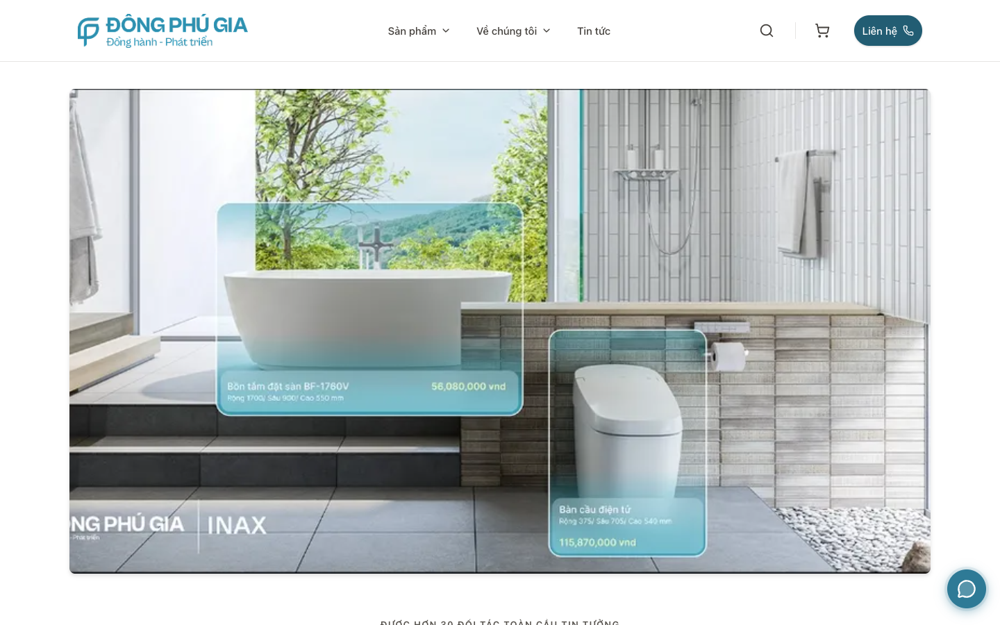

# PR #173 canonical Public UI — local visual evidence

This is a source-review artifact, **not** a Preview deployment or Production acceptance. Screenshots were captured from the locally built Cloudflare Worker using workerd and Playwright at 1440×900 desktop and 390×844 mobile viewports.

| Viewport | PR #166 visual baseline | PR #173 corrected candidate |
| --- | --- | --- |
| Desktop |  |  |
| Mobile |  |  |

The baseline is commit `adce28998a6781ae526e068604967f5e8a479fdf` from PR #166. It is used **only** to compare layout, header, hero geometry, brand strip, category hierarchy, and floating contact control. Its banner and catalogue contain unverified product/price content; those are **not** approved for publication or reused by this candidate.

The corrected candidate retains the canonical components and replaces unverified catalogue/price content with a truthful unavailable state. Search results, cart, checkout, newsletter/contact writes, listing/PDP, and other data-dependent routes remain disabled or return `503` with `Retry-After`. The candidate's image is an existing editorial interior banner; its image bytes and visible pixels contain no product price claim. The mobile navigation was opened locally without browser errors or warnings.

Local Worker proof at source commit `49f891aa068e19dac9e1d60ee4cd9506163a37d5` covered `200` with correct MIME for logo, banner, icon, and favicon; home/contact/category route behavior; Preview `noindex`; Production-host rejection; cache MISS/HIT/bypass; and Preview sitemap unavailability. The proof's CPU estimate is `UNKNOWN` until deployed Worker observability exists. The screenshots and proof do **not** establish Production UI parity or approve merge/deployment.

The `pattern-bg.png` reference from unavailable `/doi-tac` and `/du-an` routes still causes a local build warning. These routes are not served in this public-shell scope and remain `503`; the warning is retained as a follow-up rather than represented as a verified asset.
